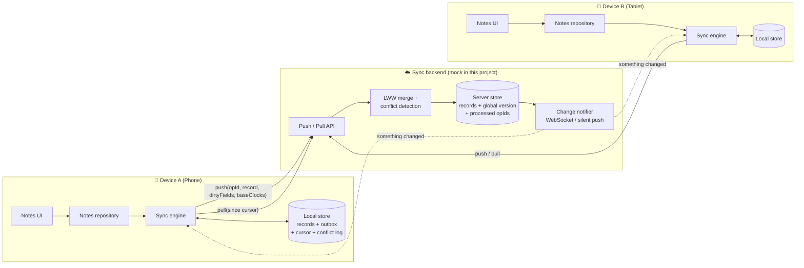
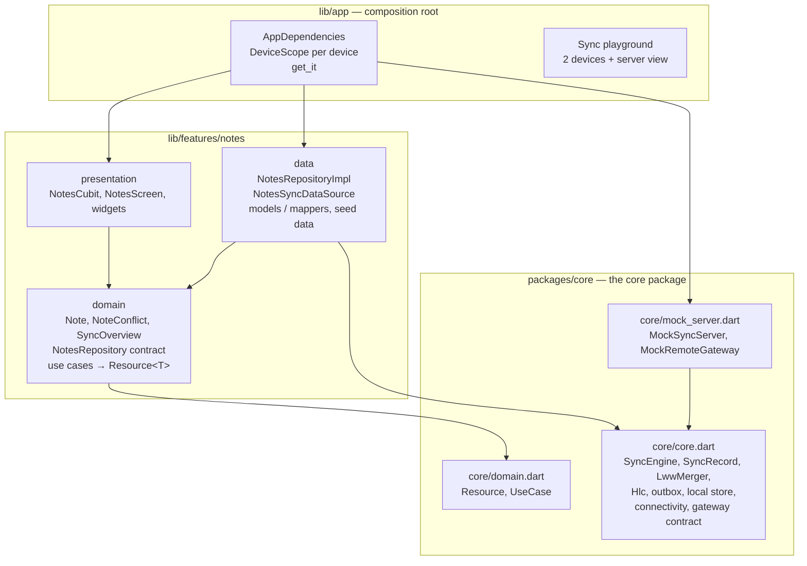
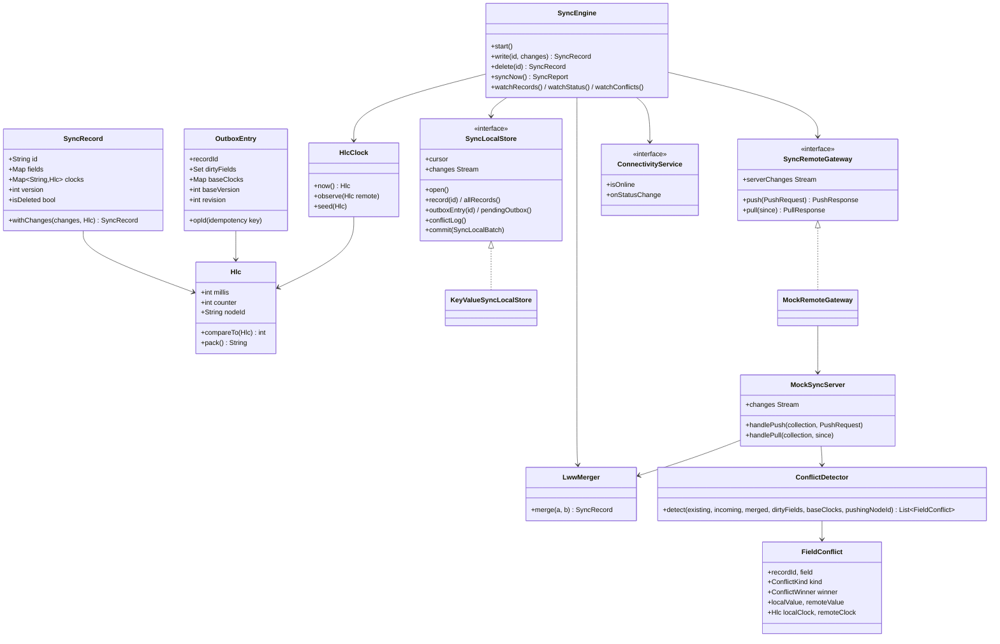
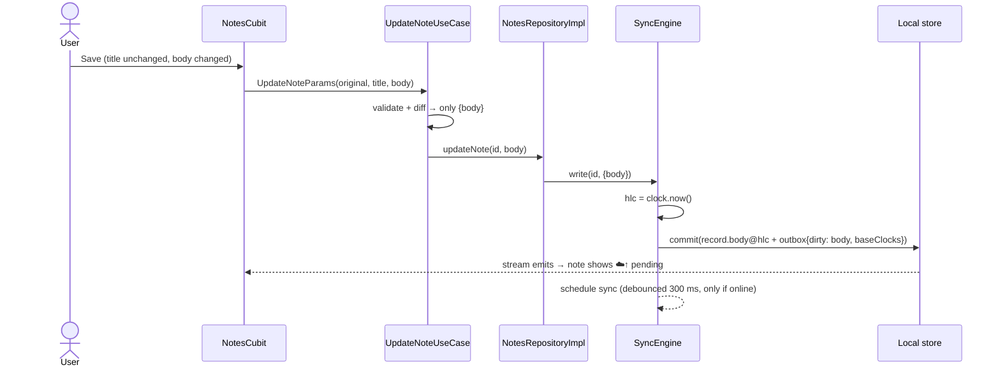
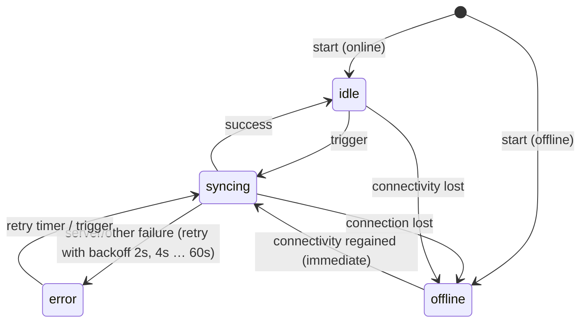
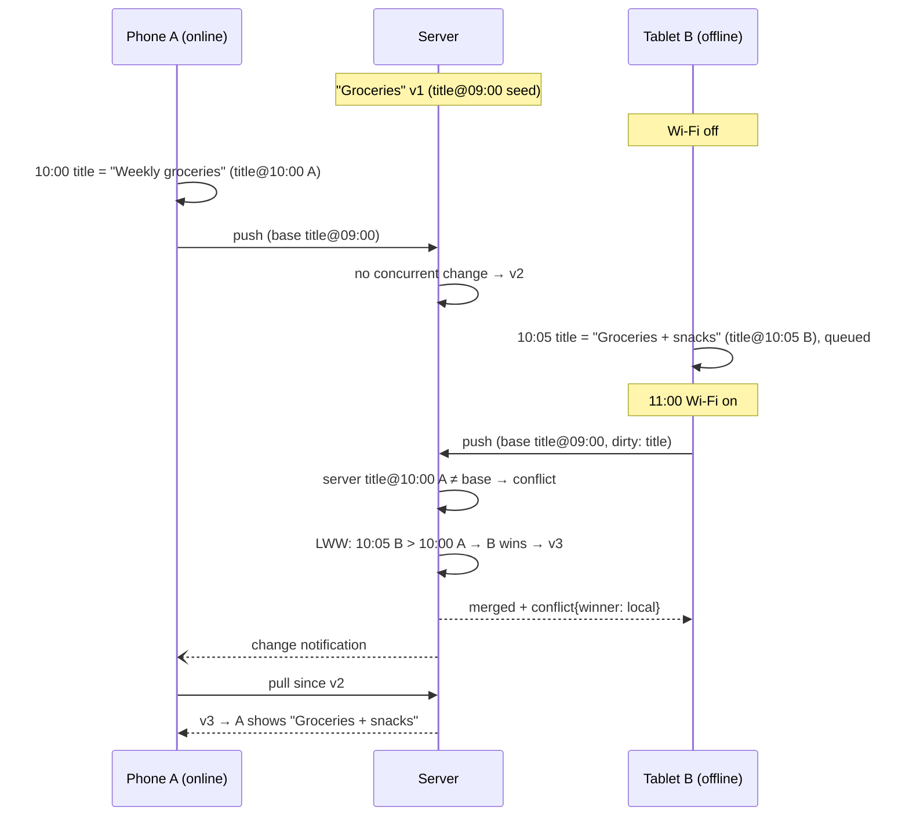

# Offline Notes: Design Document

> **Task:** "A screen shows a list of items the user can edit. It must keep working with no network and reconcile when connectivity returns. Build the core package."

This document covers the whole design: requirements, the HLD (High-Level Design), the LLD (Low-Level Design), the conflict-resolution rules ("who wins"), worked two-device scenarios, trade-offs and limitations. Every rule described here is backed by an automated test (see [Testing](#10-testing)).

---

## Contents

1. [Summary](#1-summary)
2. [Requirements](#2-requirements)
3. [High-Level Design (HLD)](#3-high-level-design-hld)
4. [Low-Level Design (LLD)](#4-low-level-design-lld)
5. [Conflict resolution: who wins and why](#5-conflict-resolution-who-wins-and-why)
6. [Two-device scenarios, step by step](#6-two-device-scenarios-step-by-step)
7. [Failure handling and guarantees](#7-failure-handling-and-guarantees)
8. [Project structure](#8-project-structure)
9. [Running the demo](#9-running-the-demo)
10. [Testing](#10-testing)
11. [Trade-offs, limitations and next steps](#11-trade-offs-limitations-and-next-steps)
12. [Glossary](#12-glossary)

---

## 1. Summary

* **Offline-first.** The local database on the device is the single source of truth. The UI (User Interface) only ever reads from it, and every create, edit and delete is written there first. No network is needed, so the app behaves identically offline.
* **Outbox.** Each local write also records a pending change in an *outbox*, in the same atomic commit. When connectivity returns, the sync engine *pushes* the outbox, then *pulls* everything that changed on the server since its last cursor.
* **Conflict rule:** *per field, the most recent **edit** wins, measured by when the edit was made, not when it was synced.* Each field (`title`, `body`, and the `deleted` flag) carries its own HLC (Hybrid Logical Clock) timestamp. Merging two copies keeps, for every field, the value with the newer timestamp. This is a LWW (Last-Writer-Wins) map, a standard state-based CRDT (Conflict-free Replicated Data Type).
* **Consequences of that rule:**
  * Different fields edited on two devices are **both kept** (title from one, body from the other).
  * The same field edited on both: the **later edit** wins, even if it reaches the server last.
  * Edit versus delete: the **later intent** wins. A newer edit restores a deleted note; a newer delete removes an edited note.
  * Every replica (both devices and the server) **converges to identical data**, whatever the order of syncs, and retries are safe.
* **Nothing waits for the user.** Conflicts are resolved automatically, but each one is logged with its winner and the replaced value, and shown in a "Conflict history" sheet, so no edit disappears silently.
* **The core package** (`packages/core`) is feature-agnostic: it knows nothing about notes. The notes feature only declares its field names. Any other "list of editable items" feature can reuse the same engine.

---

## 2. Requirements

### Functional
| # | Requirement | How it is met |
|---|---|---|
| F1 | Show a list of items (notes) the user can create, edit and delete | `NotesScreen` + `NotesCubit` + use cases |
| F2 | Every action works with no network | Writes go to the local store only; `SyncEngine.write` never touches the network |
| F3 | Reconcile automatically when connectivity returns | Connectivity listener triggers push then pull |
| F4 | Two devices editing the same item (one online, one offline) end up consistent | Per-field LWW merge on server and devices, plus delta pull |
| F5 | The user can tell what is synced and what is pending | Per-note cloud icon, status banner, pending count |
| F6 | The user can see how conflicts were resolved | Conflict log persisted per device, shown in a sheet |

### Non-functional
| # | Requirement | How it is met |
|---|---|---|
| N1 | No data loss on crash, kill or network drop | Record and outbox written atomically; outbox cleared only after the server response is applied; idempotent pushes |
| N2 | Deterministic, order-independent outcome | The merge is commutative, associative and idempotent |
| N3 | Testable without devices or a backend | In-memory store, simulated connectivity, in-process mock server |
| N4 | Clean Architecture | domain / data / presentation per feature; the core package holds reusable infrastructure |
| N5 | Replaceable backend and storage | `SyncRemoteGateway` and `SyncLocalStore` interfaces |

---

## 3. High-Level Design (HLD)

### 3.1 System context



### 3.2 Main ideas

| Concern | Decision | Why |
|---|---|---|
| Source of truth on device | Local store; the UI observes it as a stream | The UI never waits for the network; offline and online look the same |
| Write path | Local commit (record + outbox) → debounce → push | Instant UI, durable queue |
| Read path | Delta pull by server version cursor (includes tombstones) | Only changed records are transferred; deletes propagate |
| Ordering of edits | HLC per field | Total order across devices, monotonic, causality-aware |
| Conflict resolution | Per-field LWW merge; newer edit beats older delete and vice versa | Deterministic, keeps non-overlapping edits, no user prompts |
| Conflict reporting | Server detects real concurrent edits using the device's `baseClocks` | Users and auditors can see what was replaced |
| Delivery semantics | Push carries an idempotency key (`opId`) | A lost response plus a retry never applies twice |
| Sync triggers | Connectivity regained, server notification, local write (debounced), app start, manual, retry with exponential backoff | Reconciles quickly without polling |
| IDs | Client-generated UUID (Universally Unique Identifier) | Items can be created offline |

### 3.3 Layering (Clean Architecture)



* **domain** imports only `package:core/domain.dart` (pure Dart: `Resource`, `UseCase`). It has no Flutter, storage or network imports.
* **data** implements the domain contract on top of the core `SyncEngine`, and maps `SyncRecord`s to `Note` entities. No sync logic lives in the feature.
* **presentation** depends on domain only (use cases), never on data.
* **app** wires everything with get_it. Each simulated device gets its own container (`GetIt.asNewInstance()`), so the two devices in the demo are fully independent object graphs.

---

## 4. Low-Level Design (LLD)

### 4.1 Core class diagram



### 4.2 Data model

**`SyncRecord`** (generic; one per note):

```json
{
  "id": "6f1c…",                       // client-generated UUID
  "fields": { "title": "Groceries", "body": "Milk", "_deleted": false },
  "clocks": {                          // per-field HLC of the last write
    "title":    "001731493200000:00000:device-a",
    "body":     "001731493100000:00000:device-b",
    "_deleted": "001731400000000:00000:server-seed"
  },
  "version": 17                        // server's global sequence at last change
}
```

**HLC format:** `millis:counter:nodeId`. Comparison is by millis, then counter, then nodeId, so there are never ties between devices.

**`OutboxEntry`** (at most one per record; several offline edits are coalesced):

| Field | Purpose |
|---|---|
| `opId` | Idempotency key; regenerated whenever the entry's content changes |
| `dirtyFields` | Fields changed locally since the last successful push |
| `baseClocks` | The record's clocks when the first pending edit was made, i.e. what the edit was based on. Used for conflict *detection* |
| `baseVersion` | Server version at that time (diagnostics) |
| `revision` | Increments on every coalesced edit; protects edits made while a push is in flight |
| `attempts`, `lastError` | Diagnostics and backoff |

**Local store layout** (one JSON, JavaScript Object Notation, document per device and collection, so each commit is one atomic write): `{ records[], outbox[], cursor, conflicts[] }` under the key `sync.<deviceId>.notes`.

### 4.3 Write path (works offline)



The **field diff in the use case** matters: if the user did not touch the title, the title must not get a new clock, or it would wrongly override another device's title edit.

### 4.4 Sync cycle

```mermaid
sequenceDiagram
    participant E as SyncEngine (device)
    participant L as Local store
    participant G as Gateway
    participant S as Server
    Note over E: trigger: back online / server notification / local write / manual / retry
    E->>E: single-flight lock (a 2nd trigger queues one rerun)
    loop each outbox entry (oldest first)
        E->>G: push(opId, record, dirtyFields, baseClocks, baseVersion)
        G->>S: handlePush
        alt opId already processed
            S-->>G: stored response (duplicate)
        else
            S->>S: merged = LWW(serverCopy, incoming)
            S->>S: conflicts = detect(dirty fields changed by others since base)
            S->>S: version = ++globalSequence (if anything changed)
            S-->>G: merged record + conflicts
            S--)E: change notification to other devices
        end
        G-->>E: response
        E->>E: clock.observe(server clocks)
        E->>L: commit(merge(local, server); remove outbox if revision unchanged, else rebase it; log conflicts)
    end
    loop pages
        E->>G: pull(since cursor)
        G->>S: records with version > cursor (tombstones included)
        S-->>E: page + new cursor
        E->>L: commit(merge(local, remote) per record, cursor)
    end
    E->>E: status = idle, lastSyncedAt = now
```

**Why push before pull:** the server merges our edits first; the pull then brings back the final, converged state together with other devices' changes.

**Why merge on pull (not overwrite):** if the user edited a note while the cycle was running, the local edit is newer and must survive. The merge keeps it, and its outbox entry is pushed in the next cycle.

### 4.5 Sync engine states



### 4.6 Connectivity

* `DeviceConnectivityService` (real device): `connectivity_plus` gives the instant "radio off" signal, and `internet_connection_checker_plus` confirms real internet access (for example, a captive Wi-Fi portal is "connected" but not online).
* `SimulatedConnectivityService` (demo): a per-device switch, layered on the real service. Online means switch on **and** real network available.
* Connectivity is a **trigger, not a guarantee**: a push can still fail with `NetworkException` while "online". That is handled as a retryable failure, and the outbox is kept.

---

## 5. Conflict resolution: who wins and why

### 5.1 The rule

> **For every field independently, the value with the newest HLC timestamp wins. The timestamp is taken when the user makes the edit, so the device that *syncs last* has no advantage.**

Delete is treated as one more timestamped field (`_deleted`), with one extra rule so no work is silently lost:

> **A content edit newer than the delete restores the note; a delete newer than every content edit keeps it deleted.** ("Latest intent wins.")

### 5.2 Decision table

| Device A (online) | Device B (offline, syncs later) | Result on both devices | Logged as |
|---|---|---|---|
| edits **title** at 10:00 | edits **title** at 10:05 | B's title (newer edit) | concurrent edit, B won |
| edits **title** at 10:05 | edits **title** at 10:00 | A's title (newer edit) | concurrent edit, A won (B sees "yours was replaced") |
| edits **title** | edits **body** | A's title **and** B's body | no conflict (merged) |
| same title, same new value | same title, same new value | that value | no conflict (identical edits) |
| **deletes** at 10:00 | edits at 10:05 | note **restored** with B's edit | edit vs delete, edit won |
| edits at 10:00 | **deletes** at 10:05 | note **deleted** | delete vs edit, delete won |
| creates note X | creates note Y | both X and Y exist | none (different ids) |
| both offline, any edits | | after both sync, identical data on A, B and server | per the rows above |

### 5.3 Why "latest edit" and not "latest sync"

"Last sync wins" (or "server wins") would punish the offline user: a stale edit made yesterday on a plane would overwrite fresh work as soon as the plane lands. Ordering by edit time matches what the user expects ("I changed it last, so my change is kept"). It also gives a deterministic answer that every replica computes the same way.

### 5.4 Why per field and not per note

With per-note LWW, editing the body on one device and the title on another would throw one edit away. Per-field clocks keep both, and only real same-field clashes need a winner.

### 5.5 Why HLC (Hybrid Logical Clock) and not `DateTime.now()`

* **No ties:** the counter and device id give a total order, even for edits in the same millisecond.
* **Monotonic:** if a device's clock jumps backwards, its new edits still sort after its own earlier edits.
* **Causality:** when a device receives remote data, its clock is moved past it (`observe`). So if B has *seen* A's edit and then edits the same field, B's edit is guaranteed to win, even if B's wall clock is behind.
* **Remaining limitation:** for two edits made **truly concurrently on offline devices**, ordering falls back to each device's wall clock. A device whose clock is hours fast would win those clashes. Mitigations are listed in [section 11](#11-trade-offs-limitations-and-next-steps).

### 5.6 Detection versus resolution

Resolution is the merge, and it is the same whether or not a conflict is reported. Detection only *explains* the outcome:

* When a device first edits a record offline, the outbox stores the record's clocks at that moment (`baseClocks`).
* On push, the server checks each dirty field: if its server clock differs from the device's base clock **and was written by another device**, someone else edited that field in the meantime. That is a real conflict, and it is reported with the winner and the replaced value.
* Fields that are merely stale (the device didn't touch them) are not conflicts. Writes by the same device are never conflicts (this covers a retry after a lost response).

### 5.7 Convergence

`LwwMerger.merge` is commutative (`merge(a,b) == merge(b,a)`), associative and idempotent (`merge(a,a) == a`). The server and devices run the same function, so all replicas reach identical data regardless of the order of pushes and pulls, and re-sending anything is harmless. The test `all replicas converge to the server state` asserts this exactly.

---

## 6. Two-device scenarios, step by step

All of these can be reproduced in the demo (the help icon lists them) and are automated in `packages/core/test/sync/two_device_sync_test.dart`.

### 6.1 One online, one offline, same field: the later edit wins



The result is the same on A, B and the server. B's history says "Kept your edit from 10:05, newer than Phone A's 10:00". If B's offline edit had been at 09:55 instead, A's title would win and B's history would show B's replaced value.

### 6.2 Different fields: both edits survive

A edits the title online at 10:00, and B edits the body offline at 10:05. When B pushes, `title` is not dirty on B and `body` was not changed by A, so there is no conflict. The merge takes A's title (newer clock) and B's body (newer clock). Both devices end up with both changes.

### 6.3 Edit versus delete

* A deletes at 10:00 (online). B edits the body offline at 10:05. When B pushes, the server sees `_deleted` was changed by another device since B's base, so it reports *edit vs delete*. Merge: the content edit (10:05) is newer than the delete (10:00), so the note is restored with B's body. A pulls and the note reappears.
* Reverse the times (B edits at 10:00, A deletes at 10:05): the delete is newer, so the note stays deleted, and B is told its edit lost to a newer delete.

### 6.4 Both offline

Both devices queue changes. Whichever reconnects first pushes into an unchanged server (no conflicts). The second one's push is merged field by field using the same rule. Its pull brings the first device's changes. The first device gets the second device's changes via the notification or its next sync. Final state: identical everywhere.

### 6.5 Network drop mid-push

The server applies B's push, but the response is lost. B still has the outbox entry and retries with the **same `opId`**. The server recognises it and returns the stored response without applying it again, so the version is not bumped twice and no duplicate conflicts are logged. (Test: `a lost response is retried safely thanks to the idempotency key`.)

---

## 7. Failure handling and guarantees

| Failure | Behaviour |
|---|---|
| No network at all | Writes succeed locally; status banner says "Offline — N changes queued"; nothing is lost |
| Network flaps while "online" | `NetworkException` → status `error`, retry with exponential backoff (2 s → 60 s); immediate retry when connectivity is regained |
| App killed after a local edit | Record and outbox were committed together, so the edit is pushed on next start |
| App killed mid-push | Outbox entry is still there; the retry reuses the `opId`, and the server de-duplicates |
| User edits while a push is in flight | Outbox `revision` changed → entry kept and rebased on the server's clocks; the edit is pushed next cycle and no false conflict is reported |
| Many triggers at once | Single flight: one cycle runs, and at most one follow-up is queued |
| Clock jumps backwards on a device | HLC stays monotonic |

---

## 8. Project structure

```
offline_items_app/
├── PROJECT.md                     ← this document
├── README.md                      ← quick start
├── packages/core/                 ← THE CORE PACKAGE (feature-agnostic)
│   ├── lib/
│   │   ├── domain.dart            ← pure Dart: Resource<T>, UseCase (for domain layers)
│   │   ├── core.dart              ← sync infrastructure (for data layers)
│   │   ├── mock_server.dart       ← in-process backend (demo/tests only)
│   │   └── src/
│   │       ├── result/resource.dart
│   │       ├── use_case/use_case.dart
│   │       ├── clock/hlc.dart, hlc_clock.dart
│   │       ├── connectivity/connectivity_service.dart
│   │       ├── storage/key_value_store.dart
│   │       ├── sync/
│   │       │   ├── sync_record.dart        ← LWW map with per-field clocks
│   │       │   ├── lww_merger.dart         ← THE conflict rule
│   │       │   ├── field_conflict.dart     ← ConflictDetector + report types
│   │       │   ├── outbox_entry.dart
│   │       │   ├── conflict_log_entry.dart
│   │       │   ├── sync_status.dart
│   │       │   ├── sync_engine.dart        ← orchestration
│   │       │   ├── local/sync_local_store.dart
│   │       │   └── remote/sync_remote_gateway.dart
│   │       ├── mock_server/mock_sync_server.dart, mock_remote_gateway.dart
│   │       └── utils/async_lock.dart
│   └── test/ (HLC, merger, two-device scenarios)
├── lib/
│   ├── main.dart
│   ├── app/                       ← composition root + demo shell
│   │   ├── app.dart
│   │   ├── di/app_dependencies.dart, device_scope.dart
│   │   └── demo/ (playground screen, device panel, server inspector, cubits)
│   └── features/notes/
│       ├── domain/   entities/, repositories/, use_cases/ (+ params/)
│       ├── data/     datasources/, models/, repositories/, mock/seed_notes.dart
│       └── presentation/ bloc/, screens/, widgets/
├── test/ (use case, repository + engine, cubit, UI flow)
├── integration_test/conflict_scenarios_test.dart  ← real-app scenarios (recorded demo)
└── docs/media/ (demo video + screenshots)
```

---

## 9. Running the demo

```bash
flutter pub get
flutter run -d macos        # or: -d chrome, an iOS simulator or an Android emulator
```

The home screen is a **sync playground**: *Phone A*, *Tablet B* and the *Mock server*, side by side on wide windows or as tabs on a phone.

* Each device has its **own local database** and a **Wi-Fi switch** in its app bar.
* Notes show ☁️✓ (synced) or ☁️↑ (pending). The banner shows the queue and the last sync time.
* The **history** icon lists every resolved conflict with an explanation.
* The **server panel** shows each note's version and, per field, when and on which device it was last edited.
* **Reset** wipes both devices and the server, and reloads the 5 mock notes.
* `--dart-define=REAL_NETWORK=false` ignores the real network (useful if the machine is offline or behind a proxy).

The mock network adds 350 ms of latency per hop, so you can see the "Syncing…" state.

---

## 10. Testing

```bash
cd packages/core && flutter test     # 17 tests: HLC, merge algebra, two-device scenarios
cd ../.. && flutter test             # 11 tests: use case, repository + engine, cubit, UI flow
flutter test integration_test/conflict_scenarios_test.dart -d macos   # real app, ~95 s
```

The integration test runs the **real app** (in-memory storage, simulated connectivity) and plays scenarios 6.1, 6.2 and 6.3 at a watchable pace with on-screen captions. Its recording is [docs/media/offline_notes_conflict_demo.mp4](docs/media/offline_notes_conflict_demo.mp4).

| Test | Proves |
|---|---|
| `hlc_test` | Total order, round-trip, monotonic under clock rollback, `observe` causality |
| `lww_merger_test` | Per-field LWW, commutativity, idempotency, edit-vs-delete both ways |
| `two_device_sync_test` | Later offline edit wins; earlier offline edit loses; different fields merge; edit restores deleted note; newer delete wins; idempotent retry after a lost response; offline creates on both devices; all replicas converge |
| `update_note_use_case_test` | Only changed fields are written; no-op when unchanged; validation |
| `notes_repository_offline_test` | Offline create is pending, then synced; delete syncs as a tombstone; 5 mock notes load |
| `notes_cubit_test` | State from streams; offline is info, not error; validation errors surface |
| `sync_playground_test` (widget) | Through the real UI: B offline, both edit the same title, B reconnects, B's newer title shows on A, B and the server |
| `integration_test/conflict_scenarios_test` | On a real device: later edit wins, different fields merge, newer edit restores a deleted note; history sheet explains each outcome |

---

## 11. Trade-offs, limitations and next steps

| Topic | Current choice | Limitation | Production next step |
|---|---|---|---|
| Concurrent offline edits ordered by wall clock | HLC | A device with a badly wrong clock wins same-field clashes | Server rejects or clamps timestamps too far in the future (for example more than 1 minute ahead of server time); or use server-assigned ordering for online edits |
| Granularity | Per field | Two people editing the *same* body concurrently: one whole body wins | Text CRDT or operational transform for rich text (for example Yjs or Automerge), or field-level "keep both" copies |
| Resolution | Automatic | No manual merge UI | For high-value fields, keep the loser as a "conflicted copy" or let the user pick in the history sheet |
| Local storage | One JSON document in `shared_preferences` (atomic, simple) | Not for thousands of large items | Implement `SyncLocalStore` on SQLite with drift; same interface |
| Tombstones | Kept forever | Storage grows | Garbage-collect tombstones older than the maximum offline window, once all devices have pulled past them |
| Change notifications | Mock stream | — | WebSocket or FCM (Firebase Cloud Messaging) silent push; periodic background sync with WorkManager / BGTaskScheduler |
| Security | None (mock) | — | Authenticated API, per-user data partitioning, encrypted local store, wipe on logout (`SyncLocalStore.clear`) |
| DI | get_it, manual registration | — | `injectable` annotations for a single-device app; the demo needs two graphs of the same types, which is why it uses `GetIt.asNewInstance()` |

---

## 12. Glossary

| Term | Meaning |
|---|---|
| **HLD** | High-Level Design: components and how they interact |
| **LLD** | Low-Level Design: classes, data structures, algorithms |
| **HLC** | Hybrid Logical Clock: wall-clock time plus a logical counter plus a node id; gives a total, monotonic, causality-preserving order of events |
| **LWW** | Last-Writer-Wins: on conflict, the write with the greatest timestamp wins |
| **CRDT** | Conflict-free Replicated Data Type: a data structure whose replicas can be merged in any order and always converge |
| **Outbox** | Durable queue of local changes waiting to be pushed |
| **Tombstone** | A record marked deleted (kept so the deletion can sync) |
| **Delta pull / cursor** | Fetching only records whose server version is greater than the last one seen |
| **Idempotency key (`opId`)** | Unique id of a push; the server applies each id at most once |
| **Base clocks** | The field clocks a local edit was made on top of; used to tell real concurrent edits from stale data |
| **UI** | User Interface |
| **DI** | Dependency Injection |
| **UUID** | Universally Unique Identifier |
| **JSON** | JavaScript Object Notation |
| **API** | Application Programming Interface |
