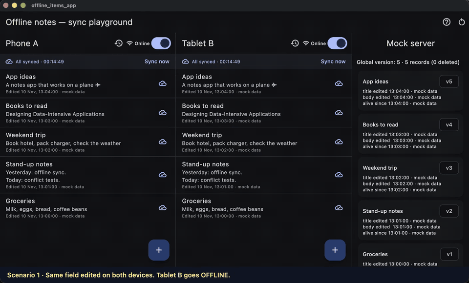
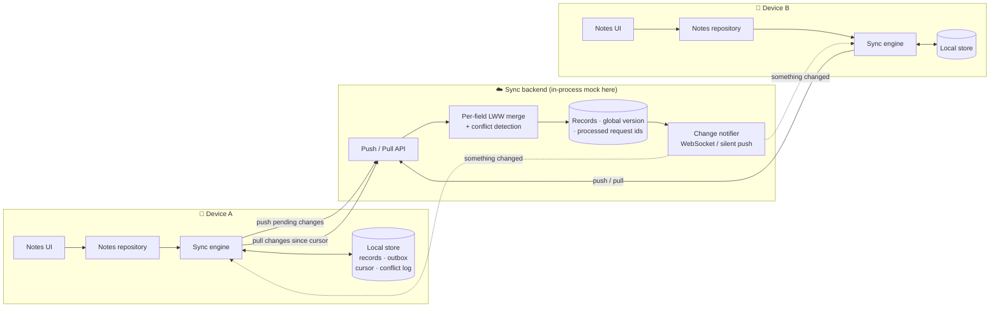
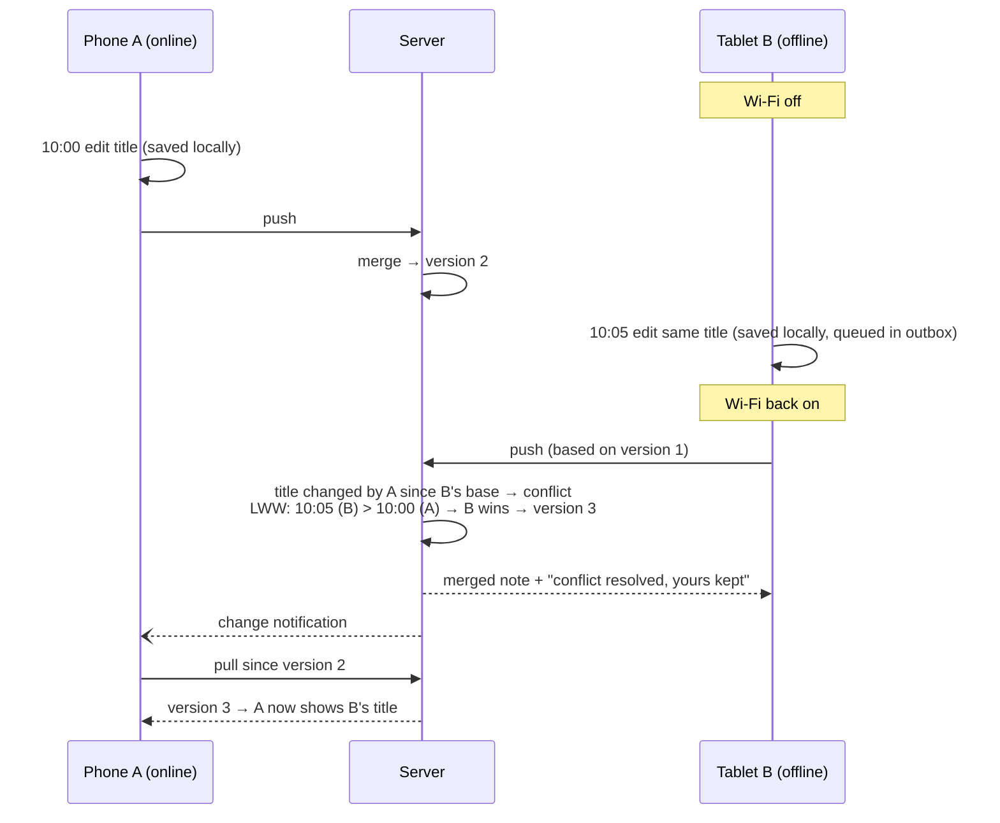
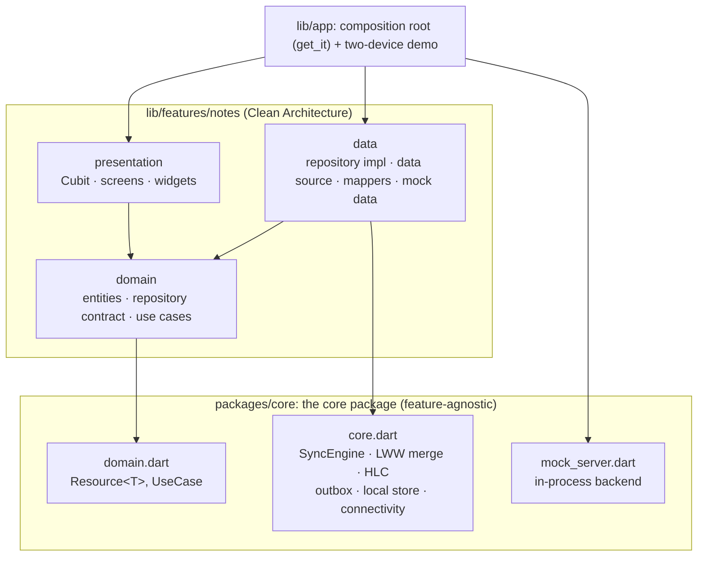

# Offline Notes: an offline-first editable list with conflict-safe sync


> **Task:** *"A screen shows a list of items the user can edit. It must keep working with no network and reconcile when connectivity returns. Build the core package."*

A Flutter notes app whose list keeps working with **no network** and **reconciles automatically** when connectivity returns, including when **two devices edit the same note while one of them is offline**. The reusable sync engine lives in its own **core package** ([`packages/core`](packages/core)); the notes feature is built on top of it with Clean Architecture.

## Demo



▶️ **[Full demo video (94 s, MP4)](docs/media/offline_notes_conflict_demo.mp4)**: recorded while an automated integration test drove the real macOS app through three scenarios:

1. **Same field, edited on both devices.** Tablet B is offline and edits *after* Phone A. On reconnect, **B's newer edit wins everywhere**.
2. **Different fields.** A edits the title while offline B edits the text. **Both edits are kept.**
3. **Edit vs delete.** A deletes a note, then offline B edits it. **The newer edit brings the note back.**

The left and middle panels are two simulated devices, each with its own local database and Wi-Fi switch. The right panel is the mock server, showing per field *when* and *on which device* it was last edited.

---

## Who wins a conflict?

> **For every field independently, the most recent *edit* wins. "Most recent" means when the user made the edit, not when it reached the server.**

| Phone A (online) | Tablet B (offline, syncs later) | Result on **both** devices and the server |
|---|---|---|
| edits **title** at 10:00 | edits **title** at 10:05 | B's title (newer edit) ✅ |
| edits **title** at 10:05 | edits **title** at 10:00 | A's title; B is told its older edit was replaced |
| edits **title** | edits **body** | A's title **and** B's body (merged, no conflict) |
| **deletes** at 10:00 | edits at 10:05 | note **restored** with B's edit |
| edits at 10:00 | **deletes** at 10:05 | note stays **deleted** |
| creates note X | creates note Y | both notes exist |

**Why this rule**
- **Fair to the offline user.** With "last sync wins", an old edit made on a plane would overwrite fresh work the moment the plane lands. Ordering by *edit time* matches what users expect.
- **Per field, not per note.** Edits to different fields never cancel each other; only true same-field clashes need a winner.
- **Deterministic.** Every replica runs the same merge function, which gives the same result in any order (commutative, associative, idempotent). All devices and the server **converge to identical data**, and retrying a sync can never corrupt anything.
- **Nothing disappears silently.** Conflicts resolve automatically without blocking the user, but each one is logged with the winner and the replaced value, and shown in a per-device **Conflict history**.

**How edit time is measured:** every field carries an HLC (Hybrid Logical Clock) timestamp, `wall-clock ms : counter : deviceId`. It never ties (the counter and device id break ties), never goes backwards (even if the device clock does), and once a device has *seen* another device's edit, its own later edits are always ordered after it. This makes the store a per-field LWW (Last-Writer-Wins) map, a well-known CRDT (Conflict-free Replicated Data Type).

---

## High-Level Design (HLD)

### System overview



### Core ideas

| Concern | Design | Why |
|---|---|---|
| **Source of truth on device** | Local store; the UI (User Interface) only observes it as a stream | The UI never waits for the network, so offline and online behave the same |
| **Writes** | Saved locally together with an **outbox** entry in one atomic commit, then pushed when possible | Instant UI; a crash can never lose a queued edit |
| **Reads from server** | **Delta pull** of records changed since the last server version (deletes included as tombstones) | Only changes travel; deletions propagate |
| **Ordering edits** | HLC timestamp per field | Total, monotonic, causality-preserving order across devices |
| **Conflict resolution** | Per-field LWW merge, run identically on server and devices | Deterministic convergence, no user prompts |
| **Conflict reporting** | The server compares against the clocks the device's edit was *based on* | Distinguishes real concurrent edits from merely stale data |
| **Exactly-once effect** | Every push carries an idempotency key | A retry after a lost response is never applied twice |
| **Sync triggers** | Connectivity regained, server notification, local edit (debounced), app start, manual, retry with exponential backoff | Reconciles quickly without polling |
| **IDs** | Generated on the device (UUID, Universally Unique Identifier) | Items can be created offline |

### Sync flow: one device online, one offline



Every sync cycle is **push first, then pull**. The server merges the device's edits before the device reads the converged state, and the device *merges* pulled data instead of overwriting it, so an edit typed during a sync is never lost.

### Architecture



- **The core package knows nothing about notes.** A feature only declares its field names; any other "editable list" can reuse the same engine.
- **domain** is pure Dart; **presentation** depends on domain only; **data** adapts the core engine to the domain contract.
- **Swappable edges:** the backend sits behind a `SyncRemoteGateway` interface (REST, Representational State Transfer, or gRPC in production) and storage behind `SyncLocalStore` (SQLite via drift for large data sets).

### Failure handling

| Situation | Behaviour |
|---|---|
| No network | Edits save locally; banner shows "Offline — N changes queued"; nothing is lost |
| Network drops mid-push | Outbox entry kept; retry reuses the same idempotency key; server de-duplicates |
| App killed after an edit | Record and outbox were committed together; pushed on next start |
| User edits while a sync is running | The newer local edit survives the merge and is pushed in the next cycle |
| Server unreachable while "online" | Retry with exponential backoff (2 s → 60 s); immediate retry when connectivity returns |

---

## Project structure

```
packages/core/            ← the core package: offline-first sync engine (+ mock backend)
lib/features/notes/       ← notes feature: domain / data / presentation
lib/app/                  ← dependency injection + two-device demo shell
integration_test/         ← real-app conflict scenarios (the recorded demo)
test/ , packages/core/test/
docs/media/               ← demo video and screenshots
PROJECT.md                ← full design document (adds the Low-Level Design)
```

## Run

```bash
flutter pub get
flutter run -d macos          # or chrome / an iOS simulator / an Android emulator
```

The app opens a **sync playground**: Phone A, Tablet B and the mock server side by side, starting with 5 mock notes. Flip a device's Wi-Fi switch to take it offline; the **?** icon lists scenarios to try, and ↻ resets the demo. Add `--dart-define=REAL_NETWORK=false` to ignore the machine's real network.

## Tests

```bash
(cd packages/core && flutter test)   # 17: clock, merge rules, two-device scenarios, idempotent retry
flutter test                         # 11: use case, repository + engine, cubit, UI flow
flutter test integration_test/conflict_scenarios_test.dart -d macos   # real app, ~95 s
```

## Known limitations

- **Clock skew.** Two edits made truly concurrently on *offline* devices are ordered by each device's wall clock, so a device whose clock is far ahead wins those clashes. In production, the server would reject or clamp timestamps from the future.
- **Same text field edited on two devices.** One whole value wins; character-level merging would need a text CRDT (for example Yjs or Automerge).
- **Storage** is one JSON (JavaScript Object Notation) document per device in `shared_preferences`: simple and atomic for a small list. Swap in SQLite for large data.
- **Tombstones** are kept forever; production would garbage-collect them after the maximum offline window.

Full details, including the Low-Level Design, are in **[PROJECT.md](PROJECT.md)**.

---

## 🤖 How this was built with AI

This project is **AI-generated**: written by Claude Code (Anthropic) and steered by me through prompts, decisions and review. The aim was to show *how* I drive an AI agent, not just the output.

**How I drove it**
- **Planning before code.** A first session only settled scope (what belongs in `core` and what in the feature) and the conflict policy. I asked the agent to walk through the logic and race conditions before anything was built.
- **House rules, written once.** My global agent instructions enforce Clean Architecture (asked once per session), full forms for every abbreviation, and documentation in every file. The agent applied them without being reminded.
- **Skills as reusable expertise.** I keep a library of **57 custom Flutter/Dart skills** (architecture, TDD (Test-Driven Development), offline sync, security, testing and more). **2 were loaded and applied here:** `flutter-clean-architecture` (layers, `Resource<T>`, Cubit, the dependency rule) and `flutter-tdd` (tests as soon as a contract is final). The agent also used the Dart MCP (Model Context Protocol) server to check the live app for runtime errors and inspect the widget tree.
- **Course-correcting in short prompts.** For example: *"I thought you would do integration test and record a video"* turned a manual screenshot into the automated, recorded integration test above.
- **Verification over trust.** Every rule in the conflict table is an executable test. The demo video is a test run, not a hand-made screen capture.

**The design evolved under review.** The first plan was "server wins on same-field conflicts", detected with server versions. While building, it changed to **"the most recent edit wins, per field"** (Hybrid Logical Clocks), because the brief's focus is the offline device: with "server wins", an offline user's newer work would lose just because it synced later. Server versions were kept, for delta pulls.

**Time (wall-clock, taken from the session transcripts)**

| Phase | Time |
|---|---|
| Session 1: scope, conflict policy, race conditions, scaffolding | 47 min |
| Session 2: build end to end (core package, feature, 28 tests, docs, verified on macOS) | 31 min |
| Integration test and recorded demo video | ~17 min |
| README with HLD, GitHub setup and publishing | ~20 min |
| **Total** | **≈ 1 h 55 min** |

Output: ~4,650 lines of documented Dart (app and core package), ~960 lines of tests, 29 automated tests.

<details>
<summary><b>Prompts I used (as typed)</b></summary>

**Session 1: planning**
1. > Create me a modular flutter app. cache, for now use sharedpreference. network listner, you can get it from pub.dev. modular and integrate this package into main. assume firsr list of 10 items are fetched, for demo put a edit icon on the list item. UI does not matter. this module package will be named as core. Here is the brief - "A screen shows a list of items the user can edit. It must keep working with no network and reconcile when connectivity returns. Build the core package". so here is the structure: we have lib - feature - core pacakge. first lets confirm as per above requirement what goes into the core pacakge
2. > Use Clean Architecture for this session? - Yes. Conflict policy default: Explain me further on this with logic anad race conditions, and how would we achieve it
3. > We would want to write unit test as soon sa the contract is final

**Session 2: build**

4. > This is the task given to me: "A screen shows a list of items the user can edit…" Now I want: lib - feature - core pacakge. And once this priject finishes I want to draw LLD and HLD of this mini project. What they are interested is in how the conflic gets handled, if user uses two different devices and if one of that device is online and one is offlince and edit takes place on either of them how the sync happens. each file needs to have proper comments and documentation. and document the whole process, at teh end I need to send them the git repo … I told you what i want, now build end to end. with mock data. and clean architecture. Add some 5 items, lets say notes app.

**Steering prompts**

5. > add the total time it took you to build
6. > I thought you would do integration test and record a video.
7. > Are you ready to put it on git? with proper readme file, so that they can see it in repo page itself when they open it along with the video. read me should also include the HLD.
8. > Please also: in the readme file, showcase AI usage, add a label ai-generated … also mention prompting used … AI time taken.

</details>

---

**Stack:** Flutter 3.47 · Dart 3.13 · flutter_bloc · get_it · shared_preferences · connectivity_plus · internet_connection_checker_plus · uuid
